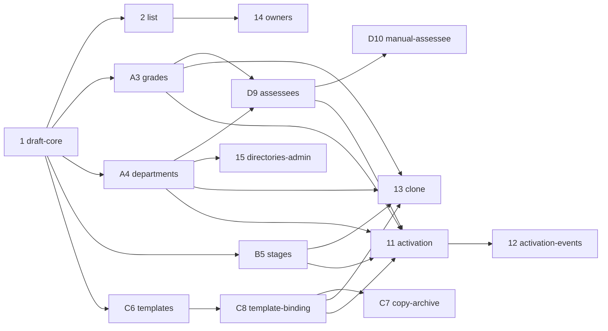

# Нарезка фазы A на OpenSpec change

Здесь фаза A («Создание и запуск КК») разбита на 15 небольших законченных задачек. Каждая задачка — один OpenSpec change. Нарезка собрана по итогам сессии 01.11. Термины — из глоссария документа «Кадровые комиссии: глоссарий и требования», решение про снимок — в ADR-0001.

## Правила нарезки

- **Одна задачка — один change.** В нём одна capability и сценарии, которые можно показать и проверить. После мержа сервис остаётся рабочим. Ориентир по размеру: до 5–7 требований в delta-спеке и 10–15 пунктов в `tasks.md`. Если change не помещается в эти рамки, его режем дальше.
- **Только бэкенд.** Фрагмент OpenAPI фиксируется в proposal, до реализации, чтобы фронт мог начинать параллельно.
- **Внешних API пока нет.** Контракты портов (`OrgStructurePort`, `PersonProfilePort`, `GradeCatalogPort`) формулируем сами. В каждом change записывается, какие поля мы ждём от внешней системы, — это требование к её владельцам. Фейки работают и в тестах, и в dev-профиле с фикстурами.
- **Заполненность вкладок растёт по срезам.** Каждый change, который добавляет обязательное поле, добавляет и своё правило заполненности. Считает агрегат, API отдаёт результат.
- **Граница фазы A.** Требования фазы A действуют до перехода КК в `ACTIVE` и после него не исполняются. Это удобно писать прямо в критерии приёмки срезов.
- **Каждая сущность черновика может быть первым изменением.** КК создаётся при первом изменении формы (FR-A02). Поэтому каждый срез, который добавляет поле, подразделения или этапы, должен уметь создать КК таким первым изменением. Делается это через `POST /commissions`, id присваивает сервер.
- **`change_log` вне фазы A**: и запись, и просмотр. Есть только аудит-поля и история статусов.

## Карта

| # | Change | Коротко | Зависит от | Волна |
| --- | --- | --- | --- | --- |
| 1 | `add-commission-draft-core` | Корень агрегата и общая инфраструктура: черновик, название, регламент, тип | — | 1 |
| 2 | `add-commission-list` | Список КК и удаление черновика | 1 | 2 |
| A3 | `add-commission-grades` | Грейды в параметрах проведения | 1 | 2 |
| A4 | `add-commission-departments` | Подразделения комиссии с руководителем и HRD | 1 | 2 |
| B5 | `add-commission-stages` | Этапы проведения | 1 | 2 |
| C6 | `add-decision-templates` | Шаблоны проектов решений | 1 | 2 |
| C8 | `add-commission-template-binding` | Привязка шаблона к КК | 1, C6 | 3 |
| D9 | `add-draft-assessees` | Оцениваемые из структуры и причина рассмотрения | A3, A4 | 3 |
| 14 | `add-commission-owners` | «Настроить доступ», владельцы комиссии | 2 | 3 |
| 15 | `add-directories-admin` | API справочников для роли поддержки | 1, A4 | 3 |
| C7 | `add-decision-template-copy-archive` | Копия и архив шаблона | C6, C8 | 4 |
| D10 | `add-manual-assessee` | Ручное добавление оцениваемого | D9 | 4 |
| 13 | `add-commission-clone` | «Создать на основе» | A3, A4, B5, C8 | 4 |
| 11 | `add-commission-activation` | «Создать»: снимок, статус `ACTIVE`, шаблон становится используемым | 1, A3, A4, B5, C8, D9 | 4 |
| 12 | `add-activation-events` | Outbox и события «КК активирована» | 11 | 5 |

Номера сохранены по сессии. Буквы обозначают параллельные ветки: A — параметры, B — этапы, C — шаблоны, D — оцениваемые.

Активация (11) не ждёт D10, C7, 13 и 14: без них КК уже можно создать и запустить. Эти четыре задачки могут идти параллельно с ней.

## Задачки

### 1. `add-commission-draft-core`

Корень агрегата `PersonnelCommission` и инфраструктура, которой пользуются все следующие срезы. Полный интент — `intent-add-commission-draft-core.md`.

- **Входит:**
  - текущий пользователь (`person_id`) через библиотеку авторизации;
  - справочник `process_owner`, наполняемый миграцией, и проверка роли;
  - суррогатные `id` и аудит-поля в каждой таблице;
  - `PersonProfilePort` с фейком для ФИО;
  - создание черновика при первом изменении (`POST`, id от сервера);
  - правка `title`, `regulation`, `type` (last-write-wins);
  - получение КК вместе с заполненностью вкладки «Параметры проведения» (название и тип);
  - история статусов `null → DRAFT`;
  - инвариант «правки только в `DRAFT`»;
  - dev-профиль с фикстурами.
- **Не входит:** список и удаление, грейды, подразделения, этапы, шаблон, `change_log`.
- **Приёмка:**
  - пустая форма ничего не создаёт;
  - первое изменение создаёт КК в `DRAFT` с id от сервера;
  - пользователь вне `process_owner` получает 403;
  - правка обновляет `updated_by` и `updated_at`.

### 2. `add-commission-list`

Главная владельца процесса: все КК и удаление черновика (FR-A01, FR-A14).

- **Входит:**
  - список всех КК всех владельцев: название (у пустого — «Без названия»), тип, статус, автор с ФИО, дата создания;
  - фильтры по типу и статусу, сортировка по дате создания;
  - физическое удаление черновика вместе со всеми дочерними строками.
- **Не входит:** колонка «у кого есть доступ» (появится в 14), фильтр по срокам.
- **Приёмка:**
  - владелец процесса видит черновики коллег;
  - удалить КК не в `DRAFT` нельзя;
  - после удаления КК пропадает из списка, а её дочерние строки удалены.

### A3. `add-commission-grades`

Грейды в параметрах проведения (FR-A04).

- **Входит:**
  - `GradeCatalogPort` с фейком;
  - `GET /grades`;
  - выбор грейдов в КК (`grade_codes[]`) с проверкой, что коды существуют;
  - выбор грейдов как первое изменение;
  - правило заполненности «≥1 грейд».
- **Грейды — вспомогательный фильтр, а не ограничение** (решение 01.11, уточняется у бизнеса). Они сужают список кандидатов во вкладке «Оцениваемые» и служат справочной информацией. Человека с другим грейдом включают только через «Добавить сотрудника» (D10). При этом выбрать хотя бы один грейд обязательно (решение 01.11).
- **Ждём от системы грейдов:** код, название, порядок сортировки.
- **Приёмка:**
  - неизвестный код отклоняется 422;
  - пока не выбран ни один грейд, вкладка не заполнена.

### A4. `add-commission-departments`

Подразделения комиссии с руководителем и HRD (FR-A04).

- **Входит:**
  - `OrgStructurePort` с фейком: подразделения верхнего уровня и проверка существования;
  - `HrdResolver` поверх справочника `hrd_assignment`, наполняемого миграцией;
  - список кандидатов с ФИО руководителя и HRD; HRD есть у каждого подразделения, он всегда определяется по структуре (решение 01.11);
  - выбор и снятие подразделений (уникально в рамках КК);
  - пометка «недоступно» для подразделения, которого больше нет в структуре;
  - выбор подразделения как первое изменение;
  - правило заполненности «≥1 подразделение».
- **Ждём от `OrgStructure`:** `org_unit_id`, название, `head_person_id`, уровень, признак «действует».
- **Приёмка:**
  - повторная отметка подразделения не создаёт дубль;
  - снятая отметка удаляет строку;
  - у каждого кандидата есть HRD. Если `HrdResolver` его не нашёл, это ошибка данных в справочнике или структуре, а не доменный сценарий.

### B5. `add-commission-stages`

Этапы проведения (FR-A06).

- **Входит:**
  - добавление, правка, удаление и порядок этапов;
  - проверка `date_from ≤ date_to`; частично заполненный этап сохраняется;
  - добавление этапа как первое изменение;
  - правило заполненности «2 этапа заполнены полностью».
- **Приёмка:**
  - один полный этап и один неполный — вкладка не заполнена;
  - два полных этапа — заполнена.

### C6. `add-decision-templates`

Шаблоны проектов решений как общий ресурс владельцев процесса (FR-A05).

- **Входит:**
  - создание шаблона, переименование;
  - варианты проектов решений: добавление, переименование, удаление, порядок;
  - поля контекста: название, обязательность, порядок;
  - список шаблонов;
  - удаление шаблона (в C8 появится ограничение для привязанных).
- **Уточняется у бизнеса:** могут ли владельцы комиссии создавать и править шаблоны, или только владельцы процесса. Рекомендация — только владельцы процесса, раз шаблон общий для всех.
- **Приёмка:**
  - шаблон с вариантами и полями сохраняется и возвращается в заданном порядке;
  - не владелец процесса получает 403.

### C8. `add-commission-template-binding`

Шаблон на вкладке «Параметры проведения» (FR-A04).

- **Входит:**
  - выбор шаблона в КК и снятие выбора;
  - выбор шаблона как первое изменение;
  - правило заполненности «шаблон выбран»;
  - черновик видит правки шаблона сразу;
  - запрет удалять шаблон, который привязан хотя бы к одной КК.
- **Приёмка:**
  - если переименовать вариант шаблона, привязанный черновик сразу показывает новое имя;
  - удалить привязанный шаблон нельзя.

### D9. `add-draft-assessees`

Оцениваемые из структуры и причина рассмотрения (FR-A07, FR-A08). После первых срезов может быть пересмотрена.

- **Входит:**
  - кандидаты «на лету» из `OrgStructure` по выбранным подразделениям; список фильтруется по выбранным грейдам, и снять этот фильтр во вкладке нельзя; у кандидата `person_id`, грейд, звено, стаж и ФИО через `PersonProfile`;
  - включение переключателя: в ALPHA только с причиной рассмотрения, в BETA и GAMMA причина необязательна (решение 01.11);
  - правка причины;
  - выключение переключателя удаляет строку вместе с причиной; при повторном включении причина заполняется заново;
  - правило заполненности: «≥1 оцениваемый в каждом подразделении», а в ALPHA — ещё и «у каждого включённого есть причина»;
  - запрет снимать подразделение, в котором есть оцениваемые: сначала их нужно выключить. Ограничение добавляется к выбору подразделений из A4.
- **В базе** хранится только `person_id`, привязка к подразделению и причина. Грейд, звено и стаж берутся при каждом показе (ADR-0001). Механика GAMMA (переключатели по умолчанию включены) не делается.
- **Решено 01.11, уточняется у бизнеса:**
  - **Снятие подразделения.** Подразделение, в котором есть оцениваемые, снять нельзя. Альтернатива на случай, если бизнес решит иначе: удалять оцениваемых вместе с подразделением после предупреждения.
  - **Грейд.** Если убрать грейд из параметров или если он изменился в `OrgStructure`, уже включённые оцениваемые остаются без пометок. Грейды — не ограничение.
- **Человек с другим грейдом** включается только через ручное добавление (D10), не из этой вкладки (решение 01.11).
- **Ждём от `OrgStructure`:** сотрудники подразделения с грейдом, звеном на уровень ниже и стажем в роли; фильтр по грейдам.
- **Приёмка:**
  - в ALPHA нельзя включить оцениваемого без причины, в BETA и GAMMA можно;
  - выключение удаляет причину, а повторное включение в ALPHA снова требует её ввести;
  - если сменить тип черновика с BETA на ALPHA, оцениваемые без причины делают вкладку незаполненной;
  - подразделение без оцениваемых делает вкладку незаполненной;
  - подразделение с оцениваемыми снять нельзя;
  - если убрать грейд из параметров, включённые оцениваемые не меняются.

### D10. `add-manual-assessee`

Ручное добавление в обход фильтров (FR-A09).

- **Входит:**
  - поиск сотрудника по всей структуре без ограничений по грейду и подразделению;
  - добавление в текущее подразделение сразу включённым, с причиной и признаком «добавлен»;
  - выключение добавленного с предупреждением, после которого он убирается из списка.
- **Повторно добавить нельзя:** если человек уже есть в этой КК, в любом её подразделении, добавить его ещё раз нельзя (решение 01.11).
- **Поиск по ФИО идёт через `PersonProfilePort`** (решение 01.11): он возвращает `person_id`, а подразделение и грейд найденного берутся из `OrgStructure`.
- **Ждём от `PersonProfile`:** поиск по ФИО (подстрока, с ограничением выдачи), в ответе `person_id` и ФИО.
- **Приёмка:**
  - добавленный вручную виден в подразделении с признаком «добавлен»;
  - без причины добавить нельзя;
  - человека, который уже есть в КК, добавить нельзя.

### 11. `add-commission-activation`

Кнопка «Создать» (FR-A10, FR-A11 без задач и уведомлений, FR-X04).

- **Входит:**
  - проверка всех правил заполненности;
  - активировать можно только `ALPHA`;
  - снимок подразделения: название, руководитель, HRD через `HrdResolver`, `snapshot_at`; привязка оцениваемых фиксируется;
  - статус `ACTIVE` и запись в истории статусов;
  - параметры после активации больше не меняются;
  - шаблон становится используемым: его нельзя менять и удалять.
- **Не входит:** доступы HRD и руководителей по снимку (первый срез фазы B), задачи и уведомления (12).
- **Приёмка:**
  - КК с незаполненной вкладкой не активируется, а ответ перечисляет, чего не хватает;
  - `BETA` и `GAMMA` не активируются;
  - после активации правка параметров отклоняется;
  - смена руководителя в `OrgStructure` после активации не меняет снимок.

### 12. `add-activation-events`

Основа для задач в Пульсе и уведомлений (FR-A11, FR-X03).

- **Входит:**
  - outbox в одной транзакции с активацией;
  - событие «КК активирована» на каждое подразделение с данными для задачи HRD и уведомления;
  - relay с фейковым получателем.
- **Не входит:** реальные адаптеры Пульса и уведомлений.
- **Приёмка:**
  - после активации в outbox лежит по событию на подразделение;
  - откат активации не оставляет событий.

### 13. `add-commission-clone`

«Создать на основе» (FR-A12).

- **Входит:**
  - копия сразу создаётся в `DRAFT` с названием «Копия — <название>»;
  - копируются параметры, подразделения по `org_unit_id` и этапы без дат;
  - ссылка на шаблон копируется, если шаблон не в архиве;
  - оцениваемые и владельцы комиссии не копируются;
  - подразделения, которых больше нет в структуре, приходят с пометкой «недоступно»;
  - действие доступно только владельцам процесса.
- **Приёмка:**
  - у копии нет дат этапов, оцениваемых и владельцев комиссии;
  - исходная КК не меняется.

### 14. `add-commission-owners`

«Настроить доступ» (FR-A13).

- **Входит:**
  - выдача и отзыв доступа к конкретной КК любому сотруднику;
  - права владельца комиссии: внутри своей КК всё, что может владелец процесса, кроме создания и «Создать на основе»; он сам выдаёт и отзывает доступ и удаляет черновик;
  - доступ плоский: можно отозвать и у того, кто выдал;
  - владелец комиссии видит в списке только свои КК; колонка «у кого есть доступ».
- **Приёмка:**
  - владелец комиссии правит свой черновик и получает 403 на чужой;
  - доступ владельцев процесса отозвать нельзя.

### 15. `add-directories-admin`

API справочников для существующей роли поддержки.

- **Входит:**
  - проверка роли поддержки через библиотеку авторизации;
  - справочник `process_owner`: добавление, деактивация, список;
  - справочник `hrd_assignment`: добавление, изменение сроков, список; проверка `org_unit_id` через `OrgStructurePort`.
- **Приёмка:**
  - добавленный владелец процесса сразу получает права;
  - деактивированный теряет их;
  - без роли поддержки — 403.

## Вне фазы A

- **Реальные адаптеры** `OrgStructure`, `PersonProfile`, системы грейдов, задач Пульса и уведомлений. По одной задачке на систему, когда появится API.
- **`change_log`**: запись и просмотр истории изменений. Требования пока не определены.
- **Доступы HRD и руководителей по снимку** — первый срез фазы B.
- **Механика GAMMA и BETA.**
