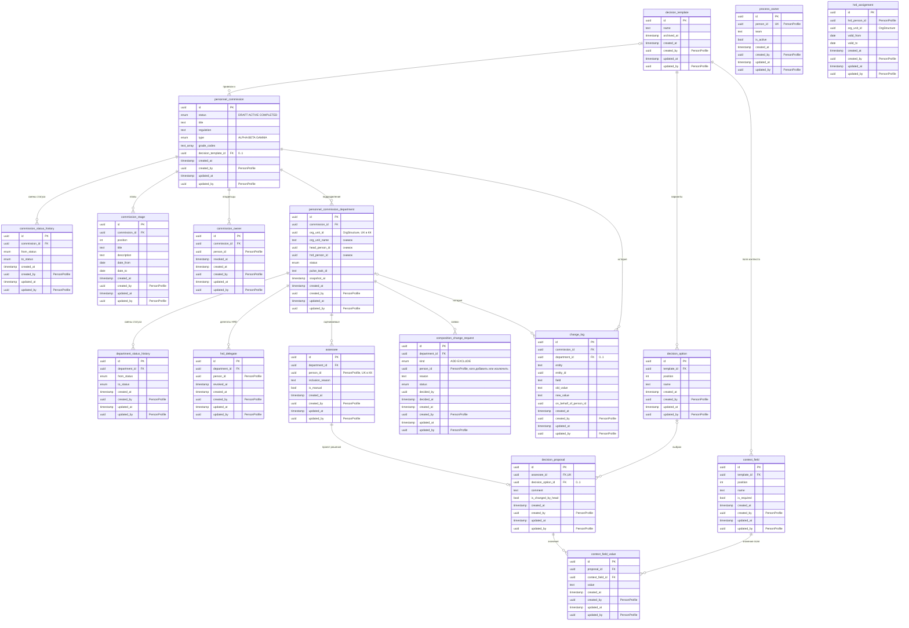

# Кадровые комиссии: глоссарий и требования

Oct 31, 2026 · @Artem

MVP охватывает подготовку альфа-КК: от создания комиссии до согласования владельцем проектов решений по всем подразделениям. Встреча, решения и всё, что после них, остаются за границей MVP. Источники: четыре сессии event-storming (ES-1 — 22.10, ES-2 — 23.10, ES-3 — 26.10, ES-4 — 27.10), фотографии доски и глоссарий команды. У каждого требования есть ссылка вида \[ES-2 24:49\]. Где позиция менялась, принята последняя, а сама смена записана в разделе «Противоречия». Термины и имена в коде сверены с глоссарием команды: где он и транскрипты расходятся, верным считается глоссарий.

## Глоссарий

Имена из глоссария команды отмечены «гл.», остальные — моё предложение (их нужно сверить с полной версией глоссария). Слово «блок» в модели не используется: единица КК называется «подразделение комиссии». В альфе подразделения комиссии совпадают с блоками оргструктуры, поэтому «блок» остаётся только в речи о структуре Пульса.

| Термин | Имя в коде | Определение | Не путать / в макетах | Источник |
| --- | --- | --- | --- | --- |
| Кадровая комиссия (КК) | `PersonnelCommission`, кратко `Commission`, таблица `personnel_commission` (гл.) | Процесс подготовки и встреча, на которой решают, по какому карьерному треку пойдёт каждый оцениваемый. В сервисе — агрегат со статусом, его создаёт владелец процесса. | «Цикл КК», `commissionCycle`, `committee`, «кадровый комитет», «КК» в коде | ES-1 04:00–07:24 |
| Тип КК | `CommissionType`: `ALPHA`, `BETA`, `GAMMA` (гл.) | Ставится вручную, по нему фильтруют список КК, и от него зависит механика. ALPHA: одна встреча топов, основное действие у HRD, переключатели по умолчанию выключены, обоснование обязательно, руководителю уведомления не идут. GAMMA: много независимых КК по подразделениям, переключатели по умолчанию включены, задача ставится руководителю. BETA не определена. Грейды выбирают отдельно, с типом они могут не совпадать. | Альфа/бета/гамма — не фазы релиза; «тильд комиссия» | ES-1 05:35; ES-2 21:45; ES-4 25:26 |
| Владелец процесса | `ProcessOwner` | Роль авторизации, её получает фиксированный перечень людей (около 5) из команд «Поддержка процесса КК» и «Центр по работе с ТОП-600». Видит и правит любые КК. Только эта роль может создавать и копировать КК. | «Админ» в макетах | ES-1 30:41–35:37; ES-2 39:30 |
| Владелец комиссии | `CommissionOwner` | Любой сотрудник, которому владелец процесса дал доступ к конкретной КК. В рамках этой КК может то же, что владелец процесса, кроме создания и копирования. | Не замещение Пульса | ES-2 26:28–38:33, 43:13 |
| Подразделение комиссии | `PersonnelCommissionDepartment`, кратко `Department`, таблица `personnel_commission_department` (гл.) | Подразделение оргструктуры, включённое в КК и зафиксированное в момент активации. У него свой статус и свой набор оцениваемых, это единица согласования и контроля полноты. В альфе это блоки, в гамме — подразделения ниже (трайб, кластер). | «Блок», «блок комиссии», `Block`, `Subdivision`, `OrgUnit`; не «этап», не «шаг», не «повестка» | ES-1 36:14; ES-2 01:12:19; ES-3 04:56 |
| Участник комиссии (презентующий) | `CommissionMember` (гл.) | Руководитель подразделения комиссии, который защищает своих оцениваемых. Входит в параметры проведения. | «Члены» в модалке, «участники» для оцениваемых | ES-1 42:17; ES-4 24:37 |
| Руководитель подразделения | `DepartmentHead` | Роль участника комиссии в сервисе: просматривает и правит проекты решений своих подразделений, ничего не согласует. На доске фазы B — «РФБ», в файлах команды — «руководитель функционального подразделения»; это та же роль. | «Руководитель блока» | ES-2 01:35:06 |
| HR-директор (HRD) | `HRDirector` | Курирует до трёх подразделений. В альфе заполняет проекты решений и отправляет подразделение на согласование. Связки HRD ↔ подразделение в Пульсе нет, её загружают списком. HRD есть у каждого подразделения: он всегда определяется по структуре (решение 01.11). | HRBP | ES-1 01:05:30; ES-2 25:03 |
| Делегат HRD | `HrdDelegate` | Подчинённый HRD (например, HRBP), которому HRD выдал доступ к одному или нескольким своим подразделениям конкретной КК. В них у делегата те же права, что у HRD, но передать доступ дальше он не может. В истории изменений видны и делегат, и HRD, который его назначил. | «Редактор подразделения», `DepartmentEditor`, «сотрудники с доступом», «редактируют параллельно»; не замещение Пульса | ES-2 01:02:13–01:05:35; ES-3 23:02–23:44; решение 31.10 |
| Председатель | `Chair` | Ведёт встречу; в альфе — CEO. В сервисе его не выбирают, права не определены. | — | ES-1 40:04, 01:02:49 |
| Приглашённый | `MeetingGuest` | Участник встречи, у которого нет своих оцениваемых. Его добавляют при создании встречи (вне MVP). | Презентующий | ES-1 40:45–41:36 |
| Эксперт | `Expert` | Даёт обратную связь по чужим оцениваемым (например, лид компетенции). Вне MVP. | «Оценивающие» | ES-1 59:38; ES-3 08:12 |
| Оцениваемый | `Assessee` (гл.) | Сотрудник, отобранный для рассмотрения на КК. Доступа к сервису не получает. | «Сотрудники», «участник», «кандидат» | ES-2 01:14:32–01:16:30, 25:59 |
| Причина рассмотрения | `InclusionReason` | Обязательный текст: почему оцениваемого включили. У поля нет автора, правки видны в истории. HRD видит этот текст в своей таблице. | «Обоснование», «комментарий» | ES-3 08:36; ES-4 01:29:10 |
| Добавленный вручную | `ManualInclusion` | Оцениваемый, найденный поиском по всей структуре в обход фильтров по подразделению и грейду. Показывается в выбранном подразделении с признаком «добавлен». | — | ES-1 01:11:19; ES-4 57:58 |
| Параметры проведения комиссии | `CommissionParams` (гл.); в базе — колонки `personnel_commission`, а не отдельная таблица (решение 31.10) | Раздел общих сведений: название (`title`), регламент (`regulation`), тип, грейды, участники комиссии. Значение-объект внутри `PersonnelCommission`: меняется только вместе с КК и только в статусе `DRAFT`. Этапы в него не входят. | «Регламент» как название раздела, «Данные КК», `CommissionData`, `PersonnelCommissionData` | ES-2 01:18:01–01:21:45; ES-4 01:22:45 |
| Регламент | `regulation` (гл.) | Текстовое поле внутри параметров проведения. | `Regulation` как имя сущности | ES-2 01:21:22 |
| Этап проведения | `PersonnelCommissionStage`, кратко `Stage` (гл.) | Информационная запись: название, описание, сроки. Логики в системе не несёт. Два этапа заполняются полностью, остальные — по усмотрению владельца. | «Блок», «шаг», `Phase`, `Milestone`; этап — про сроки, подразделение — про оргструктуру | ES-1 01:01:26; ES-4 31:51 |
| Шаблон проектов решений | `DecisionTemplate` | Переиспользуемый набор: варианты проектов решений плюс поля контекста. Общий для всех владельцев процесса, к КК привязывается на вкладке «Параметры проведения». Это единственный шаблон в домене. Версий у шаблона нет: пока он привязан только к черновикам, его правки сразу видны в них; после активации любой из этих КК он становится используемым (решение 01.11). | «Шаблон КК» — такой сущности нет | ES-2 01:23:10; ES-3 33:44–45:16 |
| Используемый шаблон | `DecisionTemplate.inUse` | Шаблон проектов решений, привязанный хотя бы к одной КК вне статуса «Черновик». Его нельзя менять и удалять: можно создать копию или архивировать. Архивный шаблон не предлагается при выборе, но остаётся виден в своих КК. | «Версия шаблона» — версий нет | Решение 01.11 |
| Создать копию шаблона | `copyDecisionTemplate` | Новый шаблон с теми же вариантами и полями контекста под именем «<имя> (копия)», не привязанный ни к одной КК. Способ изменить используемый шаблон. | «Создать на основе» (cloneCommission) — для КК | Решение 01.11 |
| Вариант проекта решения | `DecisionOption` | Пункт выпадающего списка: ротация, развитие в роли, развитие вне Сбера, развитие компетенции Disrupt и т. п. | — | ES-1 13:07; ES-2 01:25:48 |
| Поле контекста | `ContextField` | Поле свободного текста. Название, количество и обязательность задаёт владелец в шаблоне. | «Обратная связь по сотруднику» | ES-3 35:35–38:31 |
| Проект решения | `DecisionProposal` | Предложение по конкретному оцениваемому: выбранный вариант, комментарий и заполненные поля контекста. | Вариант проекта решения | ES-3 46:26 |
| Заявка на изменение состава | `CompositionChangeRequest` | Запрос HRD добавить или исключить одного оцениваемого, с обязательным обоснованием. Согласует владелец. | — | ES-2 56:07; ES-3 10:58 |
| Исключение оцениваемого | `excludeAssessee` | Удаление оцениваемого из КК вместе с причиной рассмотрения и проектом решения. Одно действие в обоих статусах: в черновике оно происходит сразу (выключение переключателя), в активной КК — после согласования заявки EXCLUDE. Пометки «исключён» нет. | «Снят с рассмотрения» на доске — то же действие в черновике | Доска, событие 17; решение 01.11 |
| Создать на основе | `cloneCommission` | Создание новой КК, у которой поля заполнены по существующей. Это не шаблон. | «Шаблон», «копирование» | ES-1 16:33; ES-2 03:23 |
| Черновик | статус `DRAFT` (гл.) | Статус КК, пока не нажата кнопка «Создать». КК в этом статусе появляется при первом заполненном поле или первом этапе, а не по «+». Только в нём можно менять параметры проведения. | — | ES-2 05:37 |
| Снимок структуры | `OrgStructureSnapshot` | Подразделения, их названия, руководители, HRD и привязка оцениваемых к подразделениям в момент активации (по «Создать»). Последующие изменения оргструктуры не отслеживаются. Атрибуты самих оцениваемых (грейд, звено, стаж) в снимок не входят и берутся при каждом показе (ADR-0001). | — | ES-2 01:12:19–01:14:03 |
| Повестка | `Agenda` | Порядок выступающих и оцениваемых на встрече. Вне MVP. Бизнес иногда называет «повесткой» регламент и параметры проведения («из года в год могут быть одни и те же повестки», ES-2 04:08); в модели и коде это слово только про встречу. | Регламент | ES-2 01:21:13; ES-4 01:43:44 |

## Роли и права

Доступ выдаётся по иерархии. Владелец процесса работает со всеми КК, владелец комиссии — с одной. HRD работает со своими подразделениями из участвующих, делегат HRD — с выданными ему. Руководитель только смотрит и правит. Таблица собрана из текста «Логика доступов и просмотров» на доске \[ES-2 24:49\], стикеров доски и обсуждений. Знак «?» стоит там, где право явно не обсуждали.

| Действие | Владелец процесса | Владелец комиссии | HRD | Делегат HRD | Руководитель подразделения |
| --- | --- | --- | --- | --- | --- |
| Видеть список КК | Все КК всех владельцев | Только КК, к которым дан доступ; другие недоступны (доска) | КК, где участвуют его подразделения | КК с выданными подразделениями | КК, где участвует его подразделение |
| Создать КК или создать на основе | Да | Нет | Нет | Нет | Нет |
| Править параметры проведения | Только в `DRAFT` | Только в `DRAFT` | Нет | Нет | Нет |
| Менять состав оцениваемых в активной КК | Согласует заявки в любой КК; напрямую — ? | Согласует заявки своей КК; напрямую — ? | Через заявку | Через заявку | Нет |
| Выдать или отозвать доступ к КК | Да, для любой КК и любому сотруднику | Да, к своей КК любому сотруднику. Список плоский: можно отозвать доступ и у того, кто его выдал. У владельцев процесса отозвать нельзя: их доступ идёт от роли (решение 01.11) | Нет | Нет | Нет |
| Видеть подразделения КК | Все | Все в своей КК | Курируемые из участвующих | Выданные | Свои из участвующих |
| Заполнить или поправить проект решения | Да, в том числе после согласования | ? | До отправки на согласование | До отправки на согласование | До отправки на согласование, с пометкой «изменено руководителем» |
| Запросить добавление или исключение оцениваемого | — (согласует) | — (согласует) | Да | Да | Нет |
| Согласовать или отклонить заявку на состав | Да, в любой КК | Да, в своей КК | Нет | Нет | Нет |
| Выдать или отозвать доступ к подразделению | ? | ? | Да, только своим подчинённым | Нет: дальше передать не может (решение 31.10) | Нет |
| Отправить подразделение на согласование | — | — | Да | Да (как HRD) | Нет |
| Согласовать подразделение | Да | Да | Нет | Нет | Нет |
| Смотреть завершённую КК | Да | Да | Да, свои подразделения | ? | Да, свои подразделения |

Оцениваемые доступа не получают \[ES-2 25:59\]. Права председателя, экспертов и приглашённых относятся к фазам за границей MVP. По тексту на доске: когда создаётся встреча, участники получают просмотр всех подразделений; после завершения КК доступы возвращаются к исходным, а у экспертов пропадают.

### Внешние системы

На доске у событий активации стоят три серых стикера внешних систем. Оргструктура и профиль упоминаются только в транскриптах. Имена систем `OrgStructure` и `PersonProfile` зафиксированы 01.11.

| Система | Что от неё нужно | Источник |
| --- | --- | --- |
| Авторизация | Роль владельца процесса; доступ к конкретной КК для владельцев комиссии; доступ к подразделениям для HRD, руководителей и делегатов HRD | Доска; ES-1 35:16 |
| Уведомления | Уведомление HRD при активации КК («колокольчик»), позже — владельцу о заявках и согласовании | Доска; ES-4 01:10:47 |
| Задачи Пульса | Задача HRD «предоставить информацию по сотрудникам» (на доске подпись обрезана) | Доска; ES-2 18:54 |
| `OrgStructure` (оргструктура) | Подразделения, руководители, грейды, стаж; связки HRD ↔ подразделение нет | ES-1 53:09, 01:13:01 |
| `PersonProfile` (профиль сотрудника) | ФИО и другие персданные по `person_id` (сервис их не хранит); поиск сотрудника по ФИО по всей компании (FR-A09, FR-B04, решение 01.11); карточка оцениваемого, способ встраивания не согласован | ES-4 01:59–09:21 |

## Жизненный цикл

&#91;embedded content: жизненный цикл · КК, подразделение, заявка на состав\]

Вся работа в MVP идёт, пока КК в статусе `ACTIVE`. Ход работы виден по статусам подразделений, а состав оцениваемых меняется через заявки — по одному человеку на заявку. Как в MVP КК станет завершённой, пока не решено. Коды статусов: `DRAFT` — из глоссария команды, `ACTIVE` и `COMPLETED` — моё предложение.

## Бизнес-требования

Бизнес-требование фиксирует, зачем нужен сервис, и не задаёт конкретного решения. Первые три взяты из вводных к проекту, остальные прозвучали на сессиях; BR-12 и BR-13 добавлены по файлу команды `08a-requirements-creation-step.md`. Цитаты взяты из автоматической расшифровки и слегка почищены. Приоритет: «MVP» — реализуется в MVP, «MVP, вне фазы A» — в MVP, но не в нарезке создания, «После MVP» — нужно учитывать в модели, но реализуется позже.

| ID | Требование | Приоритет | Обоснование | Источник |
| --- | --- | --- | --- | --- |
| BR-01 | Вся подготовка альфа-КК, от создания до согласования проектов решений по всем подразделениям, идёт в одном сервисе вместо Excel, бумаги и почты. | MVP | «Что мы там наобещали: создание новых комиссий, настройка шаблонов для заполнения, делегирование… выбор участников и сотрудников, которых мы оцениваем» | Вводные; ES-3 01:19:06 |
| BR-02 | Владелец процесса в любой момент видит, на каком этапе каждое подразделение, и не собирает это вручную. | MVP | «Владелец процесса как раз-таки следит, что вот у нас в комиссии 10 блоков участвуют… все ли из 10 блоков заполнены и согласованы» | Вводные; ES-3 54:00 |
| BR-03 | Каждая правка состава оцениваемых, обоснований, параметров проведения и проектов решений видна в истории: кто, что и когда изменил. | MVP, вне фазы A | «Она в целом доступна всем участникам, кто имеет доступ к этой комиссии, и может посмотреть, как был процесс» | Вводные; ES-4 37:24 |
| BR-04 | Раз состав и регламент повторяются, КК не собирают заново: её создают на основе прошлой, а шаблоны проектов решений служат общим ресурсом всех владельцев процесса. | MVP | «Из года в год могут быть одни и те же повестки, и нам не хочется всё это с нуля заполнять». «Повестка» здесь — регламент, а не `Agenda` (см. глоссарий) | Вводные; ES-2 04:08 |
| BR-05 | Сервис не навязывает методологию. Подразделения, грейды и оцениваемые выбираются свободно, можно добавлять исключения вне фильтров, а за корректность отвечают люди. | MVP | «Полная свобода заполнения во всех этих полях и этапах»; «кейсы могут быть абсолютно разные, и нам нужно дать им возможность свободного доступа» | ES-1 24:59, 46:01; ES-4 01:04:45 |
| BR-06 | Конфиденциальность: данные оцениваемых видны строго по роли и структуре. Доступ к чувствительным данным (грейды, доходы, оценки) со временем нужно будет аудировать. | MVP; аудит — после MVP | «Здесь мы доступ к конфиденциальной, чувствительной информации даём: грейды, зарплаты… оценки, доходы» | ES-1 32:39; ES-3 24:34 |
| BR-07 | HRD не меняет состав оцениваемых без согласия владельца. | MVP, вне фазы A | «Он не может сам просто кого-то добавить или исключить без ведома владельца процесса» | ES-3 13:24 |
| BR-08 | Завершённые КК и решения по ним хранятся и остаются доступны участникам для просмотра. Это основа для будущего отслеживания динамики. | После MVP | «У HR-директоров и у руководителей не будет отниматься доступ на просмотр, потому что нам нужно иметь возможность возвращаться к историчности данных» | ES-4 01:13:22 |
| BR-09 | Сначала делаем ALPHA, но модель должна выдержать GAMMA без переделки ядра: механика задаётся типом КК. В гамме заполняет руководитель, HRD проверяет, а все оцениваемые включены по умолчанию. BETA будут прорабатывать позже. | MVP — модель; механика GAMMA — после MVP | «Для не альфы будет немножко по-другому: у них, скорее всего, не будет предзаполнять HR за них» | ES-2 21:09–23:17; ES-3 01:26:22 |
| BR-10 | Данные по оцениваемому выглядят одинаково при заполнении и при показе председателю на встрече. | MVP, вне фазы A | «Наша задача сделать так, чтобы на этапе заполнения информации и на этапе просмотра информации \[председателем\] во время демонстрации всё было одинаково» | ES-4 06:44 |
| BR-11 | Командное: у процесса единый язык — единые термины в речи, макетах и коде. Артефакты понятны людям вне проекта и воспроизводимы (SDD на OpenSpec). | MVP | «Выравнивание терминологии и составление единого языка, который впоследствии будут использовать и разработчики в коде» | Вводные; ES-1 02:51 |
| BR-12 | Фокус КК меняется год к году (новая компетенция, новый вариант решения), и это настраивается в шаблоне проектов решений без доработки системы. | MVP | «В этом году появляется какая-нибудь новая компетенция развития Disrupt… теперь весь фокус на Disrupt. У нас должно быть одно из проектов решений — это развитие Disrupt-компетенции» | ES-2 01:25:48; файл команды 08a |
| BR-13 | Создание КК можно прервать и вернуться к нему позже, продолжив с того же места; дозаполнить черновик может и коллега. | MVP | «Спустя три дня пришёл, у тебя высвечивается черновик… начал работу, не закончил, вернулся, дозаполнил, создал» | ES-2 06:08–06:16, 08:32; файл команды 08a |

## ФТ фазы A: создание КК

Фазу A ведёт владелец процесса или владелец комиссии. Она заканчивается кнопкой «Создать»: после неё выдаются доступы и ставятся задачи. Требования фазы A действуют до перехода КК в ACTIVE и после него не исполняются. Дальше с созданной КК работают в отдельном процессе \[ES-2 47:18\].

| ID | Требование | Источник |
| --- | --- | --- |
| FR-A01 | На главной владельца процесса список всех КК всех владельцев: название, статус, автор, список имеющих доступ. Есть фильтр по типу и срокам. | ES-2 40:06–40:26; ES-4 15:42 |
| FR-A02 | Нажатие «+» открывает пустую форму, но КК ещё не создаёт. Черновик (`DRAFT`) появляется при первом изменении: когда заполнено любое поле или добавлен этап. Если форму закрыли, ничего не заполнив, КК не создаётся и в списке не появляется (решение 01.11). Дальше любое изменение поля сохраняется автоматически. Коллега с правами может дозаполнить чужой черновик и нажать «Создать». | ES-2 08:22, 12:35; ES-4 01:07:29; доска |
| FR-A03 | Мастер состоит из трёх вкладок: «Параметры проведения» (в макетах «Основное»), «Этапы», «Оцениваемые». Иконка у вкладки показывает заполненность (галочка или часики), незаполненные обязательные поля подсвечены. | ES-1 15:16; ES-2 15:40–16:57; доска |
| FR-A04 | Вкладка «Параметры проведения»: название (обязательно), тип, регламент, грейды, участники комиссии (подразделения и их руководители) и шаблон проектов решений. Подразделения выбирают чекбоксом, рядом показаны ФИО руководителя и HRD; правил выбора пока нет. Снять подразделение, в котором уже есть оцениваемые, нельзя: сначала их нужно выключить (решение 01.11, уточняется у бизнеса). Шаблон можно выбрать из существующих, создать, посмотреть или отредактировать. | ES-1 36:14; ES-3 33:44; ES-4 23:15, 25:26, 29:39; доска |
| FR-A05 | Шаблон проектов решений состоит из двух частей: список вариантов решений и поля контекста (название, обязательность, любое количество). Каждое поле хранится отдельно, чтобы можно было проверить, заполнено ли оно. Шаблон виден всем владельцам процесса. | ES-2 01:25:06, 01:31:02; ES-3 34:39–38:03 |
| FR-A06 | Вкладка «Этапы»: список этапов с названием, описанием и сроками, этапы можно добавлять и удалять. Два этапа должны быть заполнены полностью, остальные — по усмотрению владельца. Этапы чисто информационные: нет таймеров, нет рассылок, ни на что не влияют. | ES-1 57:54; ES-4 30:33–32:13; доска |
| FR-A07 | Вкладка «Оцениваемые» показывает только выбранные подразделения, а выбранные грейды служат вспомогательным фильтром. Грейды — не ограничение: человека с другим грейдом можно включить через «Добавить сотрудника» (FR-A09), а снять фильтр во вкладке нельзя. Выбрать хотя бы один грейд в параметрах обязательно, а если убрать грейд из параметров, уже включённые оцениваемые остаются (решение 01.11, уточняется у бизнеса). По структуре можно идти целиком или по отдельным подразделениям. В ALPHA переключатель «рассматривать» по умолчанию выключен, в GAMMA — включён. | ES-1 36:44, 01:10:15, 01:16:30; ES-4 41:44; доска |
| FR-A08 | В ALPHA включить оцениваемого можно только с причиной рассмотрения; в BETA и GAMMA она необязательна (решение 01.11, как в FR-08 команды). При выключении причина удаляется, а при повторном включении заполняется заново (INV-13 команды). Автора у причины нет, её правит любой с правом редактирования; правка попадает в историю. Переписки в комментариях нет. | ES-3 08:54; ES-4 47:39–51:17, 56:39; доска |
| FR-A09 | «Добавить сотрудника» ищет по всей структуре, без ограничений по грейду и подразделению; причина обязательна. Сотрудник попадает в текущее подразделение сразу включённым и с признаком «добавлен», презентует его руководитель этого подразделения. Если его выключить, система предупредит и уберёт его из списка. Человека, который уже есть в этой КК, повторно добавить нельзя (решение 01.11). | ES-1 01:11:19–01:16:14; ES-4 53:39, 57:46, 01:02:47; доска |
| FR-A10 | «Создать» доступна, когда заполнены все обязательные поля и в каждом выбранном подразделении есть хотя бы один оцениваемый. В MVP активировать можно только КК типа ALPHA (решение 01.11). | ES-4 31:16, 01:08:32; доска |
| FR-A11 | По нажатию «Создать» КК активируется (`ACTIVE`): фиксируются снимок структуры и параметры проведения. HRD и руководителям выбранных подразделений автоматически открывается доступ к их подразделениям. HRD получает задачу в Пульсе и уведомление в «колокольчике». Руководителям в ALPHA уведомлений не приходит. | ES-2 18:54–19:48; ES-4 01:09:35–01:12:33, 01:14:37; доска |
| FR-A12 | «Создать на основе» сразу создаёт черновик (правило «КК появляется при первом изменении» к нему не относится). Копируются параметры проведения, подразделения по `org_unit_id`, этапы без дат и ссылка на шаблон; название получает префикс «Копия — ». Архивный шаблон не переносится, а подразделения, которых больше нет в структуре, помечаются как недоступные. Оцениваемые и владельцы комиссии не копируются. Функция доступна только владельцам процесса. Дальше мастер проходят как при обычном создании (решение 01.11). | ES-2 03:23, 17:13–17:54, 43:13, 44:27; доска |
| FR-A13 | «Настроить доступ» доступен на главной, в мастере его нет. Владелец процесса выбирает одного или нескольких любых сотрудников, и они становятся владельцами этой КК. Доступ даётся только к конкретной комиссии, другие им недоступны. Доступ можно отозвать. Сервис замещения Пульса для этого не используется. | ES-2 26:28–37:03, 40:51; ES-4 16:14, 18:51; доска |
| FR-A14 | Действия в списке КК. Клик по строке открывает подразделения комиссии (у черновика — редактирование). В меню «три точки»: «Посмотреть данные», «Создать на основе», «Настроить доступ», а у черновика ещё «Редактировать» и «Удалить». Завершённая КК доступна только для просмотра. | ES-3 01:21:43–01:24:13, 01:22:53; ES-4 13:15–14:00; доска |
| FR-A15 | В одном сервисе может быть несколько однотипных КК (например, «ротации» дважды в год). Их различают по названию. Нужно ли ограничение «одновременно одна активная альфа», не решено. | ES-3 01:10:10–01:11:19; ES-1 06:20 |

## События фазы A на доске

Доска покрывает только фазу «Создание и запуск КК». Ниже события в порядке потока, с командами и политиками, записанными рядом на стикерах. События фазы B с доски — в разделе «События фазы B на доске» после ФТ фазы B.

| № | Событие | Команда / кто | Политики и заметки на доске |
| --- | --- | --- | --- |
| 0 | Сроки КК объявлены | Внешний триггер: Дудина сообщает, когда будет КК | Период меняется год от года. Для гаммы ВНД требует проводить КК не реже раза в год, для остальных наличие ВНД нужно уточнить |
| 1 | Выполнен переход к созданию КК с нуля | «Перейти на экран создания КК» · владелец процесса | — |
| 2 | КК скопирована | «Создать на основе» из списка КК · владелец процесса | Копируем всё, кроме списка сотрудников; даты этапов не копируем; доступы не копируются |
| 3 | Предоставлен доступ к КК (добавлены владельцы комиссии) | «Настроить доступ» → Авторизация | Доступ даётся только к конкретной комиссии; к ней можно добавлять других людей; другие комиссии им недоступны |
| 4 | Заполнены данные по КК: название, регламент | Владелец процесса или комиссии | По глоссарию это часть параметров проведения, а не «данные КК» |
| 5 | Выбраны участники комиссии (на доске «выбраны презентующие-блок») | «Выбрать презентующих» | Правил выбора пока нет. В альфе участвуют все блоки, но выбирать можно конкретные |
| 6 | Выбран тип КК | — | — |
| 7 | Выбраны грейды | — | — |
| 8 | Шаблон проектов решений создан, просмотрен, отредактирован, заполнен | — | — |
| 9 | Запланирована встреча с HRD | «Планирование встречи с HRD» | Вне MVP; рядом красные хотспоты (в транскриптах: связки HRD нет в структуре, календари топов недоступны) |
| 10 | Определены этапы проведения | «Определение этапов проведения» | Два этапа заполняются полностью, остальное на усмотрение владельца. Этапы — информационный блок без логики. Значок у вкладки показывает статус: галочка или часики |
| 11 | Просмотрена история изменений этапов | — | Показываются только изменённые разделы. Хотспот: кому показывать изменения и как |
| 12 | Выбраны оцениваемые | — | По умолчанию все переключатели выключены; для гаммы будут включены. Учитываются грейды и подразделения, выбранные ранее. HRD видит курируемые подразделения (до трёх), руководитель — только своё |
| 13 | Добавлен любой сотрудник из структуры | — | Нет ограничений по структуре и грейду. Хотспот «почему он в подразделении, а не вне» решён: оставляем добавление в подразделение |
| 14 | Указан комментарий к добавлению | — | — |
| 15 | Добавленный сотрудник исключён из рассмотрения | — | Исключать так можно только добавленного вручную; при этом появляется модалка с предупреждением |
| 16 | Заполнен комментарий: почему рассматриваем сотрудника | Включение переключателя открывает модалку | Авторство комментария не важно, но изменение должно попасть в историю КК |
| 17 | Ранее заявленный оцениваемый снят с рассмотрения | Переключатель выключен | Ранее внесённый комментарий пропадает |
| 18 | Сохранён черновик КК | Автоматически | Изменения сохраняются автоматически; статус «черновик». Уточнение 01.11: черновик сохраняется при первом изменении, пустая форма КК не создаёт |
| 19 | КК создана | «Создать КК» | КК переходит в статус «активная»; в каждом подразделении должен быть выбран хотя бы один сотрудник |
| 20 | Сформировано уведомление для HRD | → Уведомления | — |
| 21 | Задача в Пульсе выставлена для HRD | «Выставить задачи» → Задачи Пульса | — |
| 22 | Доступ участнику предоставлен | «Предоставить доступ участникам» (HRD, руководитель подразделения) → Авторизация | Доступ выдаётся по структуре: руководитель и HRD видят только своих оцениваемых; у HRD может быть несколько подразделений |

## ФТ фазы B: подготовка проектов решений

Фаза B начинается с задачи HRD и заканчивается, когда владелец согласовал все подразделения комиссии. На этом граница MVP \[ES-3 01:17:51; ES-4 01:41:02\].

| ID | Требование | Источник |
| --- | --- | --- |
| FR-B01 | HRD видит КК, в которых участвуют его подразделения: сейчас активные, позже и завершённые. Попасть в КК можно из задачи в Пульсе или из письма. | ES-2 52:52, 01:06:06; ES-4 01:17:34 |
| FR-B02 | На странице КК HRD видит только те свои подразделения, которые участвуют в этой КК, а не все курируемые. У каждого подразделения: статус, число оцениваемых, руководитель и список имеющих доступ. | ES-2 54:09–54:48, 01:09:36 |
| FR-B03 | Сверху страницы есть ссылка «Параметры проведения комиссии»: только просмотр параметров и этапов, которые заполнил владелец. | ES-2 55:37, 01:21:22; ES-4 01:23:01 |
| FR-B04 | Страница подразделения комиссии показывает список оцениваемых: ФИО, проект решения, структурное звено на уровень ниже (управление, дивизион), стаж в роли и причину рассмотрения. Есть поиск по ФИО, сортировка по стажу (при стаже в роли больше пяти лет ставят ротацию) и фильтр по проекту решения. Счётчик «заполнено N из M»; дедлайна нет. | ES-2 57:56; ES-3 06:44–08:43, 01:01:20, 01:08:55 |
| FR-B05 | Клик по строке открывает карточку оцениваемого: профиль и проект решения. В проекте решения: вариант из списка привязанного шаблона, свободный комментарий и поля контекста (обязательные помечены \*). HRD шаблон не выбирает. Как показывать профиль, пока не решено (см. открытые вопросы). | ES-3 26:24–46:42; ES-4 01:43–07:45 |
| FR-B06 | «Сохранить» сохраняет карточку и открывает следующего оцениваемого, крестик возвращает к списку. Сохранённая карточка открывается на просмотр, кнопка «Редактировать» переводит её в правку. Карусель показывает «N из M». | ES-3 47:33–51:10 |
| FR-B07 | Руководитель подразделения смотрит карточки и правит карандашом проект решения и каждое поле контекста. Его правка помечается «Изменено руководителем». Он не согласует и не меняет состав, уведомлений в ALPHA не получает. | ES-2 01:35:06; ES-3 13:39, 50:42, 01:12:21; ES-4 01:15:53 |
| FR-B08 | Заявка на добавление: HRD или делегат HRD ищет человека по всей структуре и пишет обязательное обоснование. Одна заявка — один человек. | ES-2 56:07; ES-3 16:16–16:56 |
| FR-B09 | Заявка на исключение: в меню «три точки» выбирают «Исключить» и пишут обязательное обоснование; строка уходит в серую зону «Запрос на исключение». Пока владелец не принял решение, заявку можно отменить. | ES-3 09:40–15:15; ES-4 01:27:56 |
| FR-B10 | У владельца процесса (по любой КК) и владельца комиссии (по своей) на странице КК есть раздел «Запросы на изменение состава». Каждый запрос показан отдельно с обоснованием, его можно согласовать или отклонить; массовых действий нет. Состав меняется только после согласования, а отклонённое добавление просто исчезает. При согласованном исключении оцениваемый удаляется из КК вместе с причиной и проектом решения (решение 01.11). | ES-2 57:04–57:30; ES-3 10:58–15:29, 18:07–19:26 |
| FR-B11 | HRD выдаёт доступ к конкретному подразделению своим подчинённым по оргструктуре; они становятся делегатами HRD и передать доступ дальше не могут. На подразделении видно, у кого есть доступ: руководитель и делегаты HRD с ФИО. Доступ можно отозвать. | ES-2 01:02:44–01:05:35; ES-3 23:02–24:40, 01:02:35–01:04:58 |
| FR-B12 | Кнопка «Отправить на согласование» работает на уровне подразделения комиссии. Она становится активной, когда у всех его оцениваемых заполнен проект решения. После отправки подразделение получает статус «На согласовании», правки руководителя и HRD закрываются (для HRD см. противоречие №8). | ES-2 01:22:15; ES-3 52:50–54:14; ES-4 01:13:47; доска ES-2 24:49 |
| FR-B13 | Владелец проверяет полноту (что вместо текста не стоят прочерки) и согласует подразделение. После этого изменения может вносить только владелец процесса; другие роли просят его об этом вне системы. | ES-3 57:13, 01:32:02; ES-4 01:14:07; доска ES-2 24:49 |
| FR-B14 | Все роли видят статус подразделения комиссии: Не заполнено → В процессе → На согласовании → Согласовано. Статусная модель одинакова для ALPHA и GAMMA. | ES-3 01:15:48, 01:26:42 |
| FR-B15 | Когда все подразделения комиссии согласованы, этап MVP закончен. Кнопка «Создать встречу» появится в следующей фазе. | ES-3 01:00:36, 01:17:51 |

## События фазы B на доске

Фреймы «Подготовка проектов решений (HRD ↔ РФБ)» и «Фрейм 4» доски (фотографии 01.11). События идут в порядке потока, их названия — как на стикерах, поэтому в них осталось слово «блок». Почти всё совпадает с FR-B. Новое с доски: уведомления владельцам обязательны, дедлайна не будет, владелец комиссии согласует заявки своей КК, а для делегирования и отзыва доступа ещё нет дизайна.

| № | Событие | Кто | Политики и заметки на доске |
| --- | --- | --- | --- |
| 1 | Выполнен переход на страницу со списком комиссий | HRD / делегат | Список комиссий, в которых участвует HRD (FR-B01) |
| 2 | Выполнен переход на страницу конкретной комиссии | HRD / делегат | На странице: подразделения, кому выдан доступ, статус, оцениваемые (FR-B02) |
| 3 | Предоставлен доступ к блоку | HRD | Флоу экранов делегирования пока не отрисован. Стикер «нужен термин для сотрудников, которым HRD выдаёт доступ» закрыт термином «делегат HRD» (FR-B11) |
| 4 | Список блоков КК просмотрен | HRD / делегат | Структура фиксируется на момент создания КК (FR-X04) |
| 5 | Выполнен переход на страницу блока | HRD / делегат | — |
| 6 | Данные кадровой комиссии просмотрены; общая информация просмотрена | HRD / делегат | «Редактируют» — сотрудники с доступом к заполнению; по нажатию на группу видны их ФИО. Нужна возможность отозвать ранее выданный доступ — нужен дизайн. «Дедлайна не будет!». «Данные КК» по глоссарию — «Параметры проведения комиссии» (FR-B03, FR-B11) |
| 7 | Список оцениваемых КК просмотрен | HRD / делегат | Стаж влияет на ротацию, сортировка по стажу должна быть (FR-B04) |
| 8 | Причина рассмотрения заполнена. На деле это обоснование в заявке на добавление (FR-B08); причину рассмотрения HRD в активной КК не правит (уточнено 01.11) | HRD / делегат | — |
| 9 | Просмотрен проект решения по оцениваемому → переход в профиль для заполнения проекта решения выполнен | HRD / делегат | Дополнительная оценка экспертов — не в MVP. В дизайне: заменить «обратную связь» на «контекст проекта решения» и добавить корректировку проекта решения (FR-B05, FR-X06) |
| 10 | Проект решения выбран; комментарий к проекту решения заполнен; контекст проекта решения заполнен | HRD / делегат | На доске «проект решения выбран» — по глоссарию выбран вариант проекта решения (FR-B05) |
| 11 | Проект решения сохранён; проект решения отредактирован | HRD / делегат | FR-B06 |
| 12 | Запросить мнение эксперта | HRD | Потенциально не в MVP |
| 13 | Дополнительный сотрудник добавлен в список оцениваемых | HRD / делегат | Через заявку на добавление (FR-B08) |
| 14 | Оцениваемый выбран для исключения → комментарий-причина исключения заполнен | HRD / делегат | Массово не исключаем (FR-B09) |
| 15 | Запрос на исключение отменён | HRD / делегат | FR-B09 |
| 16 | Информация по блоку отправлена на согласование владельцу процесса | HRD / делегат | Перед отправкой проверяется, что проекты решений заполнены по всем оцениваемым. Владельцу уходит уведомление о необходимости согласования (FR-B12, FR-X03) |
| 17 | Согласование исключения владельцем выполнено → оцениваемый исключён из списка | Владелец процесса; владелец комиссии — по своей КК | «Может ли владелец комиссии согласовывать исключение и добавление?» → «может по своей комиссии». «Нужна ли нотификация владельцам?» → «уведомление должно быть» (FR-B10, FR-X03) |
| 18 | Блок согласован | Владелец процесса / владелец комиссии | FR-B13 |
| 19 | Все блоки согласованы | Владелец | «Нужна ли статистика по заполненности блоков? Саша обсудит» (FR-B15) |
| 20 | КК завершена | Владелец | Статусная модель КК: черновик → активная → завершена. Как КК становится завершённой, на доске не написано; вопрос остаётся открытым |
| 21 | Профиль сотрудника запрошен к актуализации (команда «Запросить актуализацию профилей») | Владелец | Потенциально не в MVP |

## Сквозные требования

| ID | Требование | Источник |
| --- | --- | --- |
| FR-X01 | Роль «владелец процесса» — роль авторизации, её выдают по списку от бизнеса. Связку HRD ↔ подразделения загружают отдельным справочником, потому что в Пульсе её нет. Руководителя подразделения берут из оргструктуры. | ES-1 35:16, 53:09; ES-2 25:03, 37:17 |
| FR-X02 | Вне фазы A (решение 01.11): требования к истории ещё не сложились, пока есть только аудит-поля и история статусов. История изменений КК хранит поле, старое и новое значение, автора и время правки. Минимальный охват: параметры проведения и этапы, состав оцениваемых, причины рассмотрения, заявки, проекты решений, выданные доступы. На доске записано, что в истории показываются только изменённые разделы. Кому её показывать — открытый вопрос. | ES-4 32:54–39:17, 50:03; доска |
| FR-X03 | Уведомления. При активации КК HRD получает задачу и уведомление. Владелец получает уведомление о новой заявке на состав и о подразделении, ушедшем на согласование. HRD — по запросам к нему. Руководителям в ALPHA ничего не отправляется. | ES-3 19:38–20:40, 57:51; ES-4 01:10:47; доска |
| FR-X04 | Снимок структуры делается в момент активации: в КК хранятся название подразделения, его руководитель, HRD и привязка оцениваемых к подразделению на момент «Создать». Переименования, переводы и увольнения после этого момента состав КК не меняют. Грейд, звено и стаж оцениваемого не фиксируются: их получают по `person_id` при каждом показе. Уволившегося оцениваемого исключает HRD или владелец процесса; активацию это не блокирует (ADR-0001). | ES-2 01:12:19–01:14:03; ES-4 01:19:01; глоссарий |
| FR-X05 | После завершения КК у HRD и руководителей остаётся право просмотра, а редактирование закрыто для всех. | ES-4 01:12:51–01:14:16; доска ES-2 24:49 |
| FR-X06 | Единые термины в интерфейсе: «оцениваемые» вместо «сотрудники» и «участники», «подразделение комиссии» вместо «блок», «участники комиссии» вместо «члены», «контекст» вместо «обратная связь», «причина рассмотрения» вместо «обоснование», «Параметры проведения комиссии» вместо «Регламент» и «Данные КК» (в ES-4 макеты переименовали в «Данные КК», а глоссарий это запрещает). | ES-1 42:28; ES-2 01:15:22, 01:17:35; ES-3 38:05; ES-4 24:37, 01:29:23 |

## Схема данных MVP

Корень агрегата — КК, а рабочая единица — подразделение комиссии. На подразделении висят оцениваемые, проекты решений, заявки и делегаты. Оргструктура (`OrgStructure`) и грейды — внешние сервисы: в черновике хранятся их id, при активации нужные поля копируются в снимок и больше не синхронизируются. Люди везде хранятся как `person_id` из `PersonProfile`, в том числе в полях `*_by`. ФИО и другие персданные сервис не хранит и запрашивает в `PersonProfile` при показе; поиск по ФИО (FR-B04, FR-A09) тоже зависит от него. Владельцы процесса и связка HRD ↔ подразделение — свои справочники с админкой. Смены статусов КК и подразделения пишутся в отдельные таблицы истории. Имена таблиц из глоссария команды сохранены, остальные — предложение.

На ER-диаграмме все 17 таблиц с кардинальностью связей: `||--o{` — один ко многим, `||--o|` — один к нулю или одному, `|o--o{` — необязательная ссылка с той стороны, где кружок. Ссылки на внешние системы (`person_id` из `PersonProfile`, `org_unit_id` из `OrgStructure`) — не внешние ключи и помечены комментарием у поля, поэтому справочники `process_owner` и `hrd_assignment` стоят без связей. В каждой таблице показаны аудит-поля created\_at, created\_by, updated\_at, updated\_by; авторы хранятся как person\_id. `change_log` вне фазы A, но остаётся на схеме: он привязан к КК и подразделению, а на любую другую сущность ссылается парой `entity` + `entity_id`, которая связью не рисуется.

Общие правила для всех таблиц (решение 01.11):

- У каждой таблицы есть собственный суррогатный ключ `id`. Внешние идентификаторы (`person_id`, `org_unit_id`) и пары связей первичным ключом не бывают; их уникальность задаётся отдельным индексом.
- В каждой таблице есть `created_at`, `created_by`, `updated_at`, `updated_by`. Автор всегда хранится как `person_id`. В таблице ниже эти четыре поля не повторяются.
- Аудит-поля заменили доменные дубли: «кто и когда выдал доступ», «кто подал заявку», «кто сменил статус» и автор записи в `change_log` — это `created_by` и `created_at` соответствующей строки. Отдельно остались только поля с другим смыслом: `decided_by` и `decided_at` у заявки, `revoked_at` у доступов, `snapshot_at` у подразделения, `on_behalf_of_person_id` в истории.
- Строки `commission_status_history`, `department_status_history` и `change_log` не меняются: `updated_*` в них равны `created_*` и есть только ради единого формата.
- Аудит-поля показывают только последнее состояние строки. Полная история правок лежит в `change_log`.

| Таблица | Ключевые поля (кроме аудита) | Правила |
| --- | --- | --- |
| `process_owner` | `id`, `person_id` (unique), `team`, `is_active` | Справочник с админкой. Даёт право создавать и копировать КК и видеть все КК. `created_by` — кто добавил в справочник |
| `hrd_assignment` | `id`, `hrd_person_id`, `org_unit_id`, `valid_from`, `valid_to` | Справочник с админкой. Читается через порт `HrdResolver`: если HRD решат вычислять по структуре, меняется только адаптер, а таблица уходит |
| `personnel_commission` | `id`, `status` (`DRAFT` / `ACTIVE` / `COMPLETED`), `title`, `regulation`, `type` (`ALPHA` / `BETA` / `GAMMA`), `grade_codes[]`, `decision_template_id` | Корень агрегата. Параметры проведения (`CommissionParams`) в коде остаются значением-объектом, а в базе лежат колонками этой таблицы; меняются только в `DRAFT`. Грейды — коды из внешнего справочника. `status` — текущий статус для фильтров на главной. `created_by` — автор КК в списке |
| `commission_status_history` | `id`, `commission_id`, `from_status`, `to_status` | Запись на каждый переход (первое сохранение черновика, активация, завершение) в одной транзакции со сменой `status`. Кто и когда — `created_by` и `created_at` |
| `commission_stage` | `id`, `commission_id`, `position`, `title`, `description`, `date_from`, `date_to` | При активации нужны минимум два полностью заполненных этапа. При «Создать на основе» даты обнуляются |
| `commission_owner` | `id`, `commission_id`, `person_id`, `revoked_at` | Владельцы комиссии. Активный доступ уникален по (`commission_id`, `person_id`). `created_by` — кто выдал, `updated_by` при отзыве — кто отозвал. При копировании не переносятся |
| `decision_template` | `id`, `name`, `archived_at` | Общий для всех владельцев процесса. Используемый шаблон (привязан хотя бы к одной КК вне `DRAFT`) не меняется: его копируют или архивируют (`archived_at`). Удалить можно только шаблон, не привязанный ни к одной КК. Версий нет (решение 01.11) |
| `decision_option` | `id`, `template_id`, `position`, `name` | Варианты проекта решения |
| `context_field` | `id`, `template_id`, `position`, `name`, `is_required` | Поля контекста |
| `personnel_commission_department` | `id`, `commission_id`, `org_unit_id`, `org_unit_name`, `head_person_id`, `hrd_person_id`, `status`, `pulse_task_id`, `snapshot_at` | В черновике хранит выбор и `org_unit_id`, уникальный в рамках КК. При активации фиксируется снимок: название, руководитель, HRD через `HrdResolver`. Руководитель здесь же и есть участник комиссии, поэтому `CommissionMember` отдельной таблицей не вынесен. Доступ HRD и руководителя следует из этих полей |
| `department_status_history` | `id`, `department_id`, `from_status`, `to_status` | Отправка на согласование и согласование: кто и когда — `created_by` и `created_at` |
| `hrd_delegate` | `id`, `department_id`, `person_id`, `revoked_at` | Выдать доступ может только HRD подразделения и только своему подчинённому; делегат дальше не передаёт. Активный доступ уникален по (`department_id`, `person_id`). `created_by` — HRD, который выдал |
| `assessee` | `id`, `department_id`, `person_id`, `inclusion_reason`, `is_manual` | Строка появляется, когда включают переключатель. Исключение всегда удаляет строку вместе с причиной и проектом решения: в `DRAFT` сразу, после активации — в момент согласования заявки (решение 01.11). Кандидатов с выключенным переключателем сервис не хранит: их список строится из оргструктуры на лету. Грейд, звено и стаж не хранятся и берутся по `person_id` при каждом показе; фиксируется только привязка к подразделению (ADR-0001) |
| `decision_proposal` | `id`, `assessee_id` (unique), `decision_option_id`, `comment`, `is_changed_by_head` | 1:1 с оцениваемым. Заполненным считается, если выбран вариант и заполнены все обязательные поля контекста |
| `context_field_value` | `id`, `proposal_id`, `context_field_id`, `value` | Одно значение на поле: (`proposal_id`, `context_field_id`) уникальны |
| `composition_change_request` | `id`, `department_id`, `kind` (`ADD` / `EXCLUDE`), `person_id`, `reason`, `status` (`PENDING` / `APPROVED` / `REJECTED` / `CANCELLED`), `decided_by`, `decided_at` | Одна заявка — один человек. И для `ADD`, и для `EXCLUDE` в заявке хранится `person_id`: ссылки на строку `assessee` нет, потому что при согласовании исключения она удаляется. Состав меняется в момент `APPROVED`. Сама заявка остаётся: кто, кого и почему исключил. `created_by` — кто подал заявку |
| `change_log` | `id`, `commission_id`, `department_id`, `entity`, `entity_id`, `field`, `old_value`, `new_value`, `on_behalf_of_person_id` | Вне фазы A (решение 01.11). Запись на каждое изменение в одной транзакции с ним. Автор и время правки — `created_by` и `created_at`. Если правил делегат, в `on_behalf_of_person_id` стоит HRD. Кому её показывать, ещё не решено |

Решения, которые схема фиксирует сверх требований. Это мои предложения, их нужно подтвердить:

1. Версий шаблона нет (решение 01.11). Правку привязанного шаблона закрывает запрет: используемый шаблон можно только скопировать или архивировать. Если шаблоны начнут часто править на ходу, версии можно добавить позже.
2. Участник комиссии = руководитель в строке подразделения. Если команда решит иначе, `commission_member` выносится в отдельную таблицу без изменения остальных.
3. Доступ HRD и руководителя не хранится отдельно, а выводится из снимка подразделения. Отдельные записи есть только у выданных вручную доступов (владельцы комиссии, делегаты HRD).
4. Задачи и уведомления уходят в Пульс через outbox в той же транзакции, что и активация. В подразделении хранится `pulse_task_id`, чтобы потом закрыть задачу. Технические таблицы (outbox, миграции) на схеме не показаны.
5. Грейд, звено и стаж в роли не хранятся и получаются по `person_id` при каждом показе (решение 01.11). Стаж нужен для сортировки (FR-B04), так что в фазе B сортируем по данным внешней системы. Источник — `OrgStructure` или `PersonProfile` — нужно уточнить.
6. История статусов ведётся не только для КК, но и для подразделения (`department_status_history`): «кто отправил на согласование» и «кто согласовал» нужны так же, как даты активации и завершения КК.
7. В КК нет поля `version`, поэтому одновременные правки черновика двумя владельцами разрешаются по принципу «последняя запись побеждает». Если это станет проблемой, оптимистическую блокировку можно добавить позже, не меняя остальную схему.

## За границей MVP

Сроки в таблице переданы так, как прозвучали на сессиях; год там обычно не называли. Пункты важно держать в голове при проектировании модели данных, чтобы потом не переделывать MVP.

| Что | Суть | Когда называли | Источник |
| --- | --- | --- | --- |
| Встреча с HRD при создании | Встреча в календаре для HRD выбранных подразделений, одна на всех. Календари топов недоступны | В MVP не вошло | ES-1 50:45–55:51; доска |
| Запрос актуализации профиля | Уведомить оцениваемых, чтобы обновили профиль. Не привязан к созданию КК | Не первый приоритет | ES-2 45:46–47:40 |
| Эксперты и «Запросить мнение» | Обратная связь по чужим оцениваемым, колонка и вкладка «Оценка экспертов», временный доступ эксперта | «В третьем квартале» | ES-1 01:00:23; ES-3 08:12, 28:08; ES-4 01:13:00 |
| Инсайты и мэтчинг | Вторая вкладка карточки. Концепция не согласована, есть риск дублировать профиль | «К концу четвёртого квартала», под вопросом | ES-3 27:43–31:15; ES-4 01:43–06:01 |
| Теги под проектом решения | Дополнительные признаки оцениваемого. Кроме «преемника», их неоткуда взять | Не MVP | ES-2 01:31:19 |
| Подготовка к встрече (фаза C) | «Создать встречу», повестка с порядком выступающих и оцениваемых, приглашённые, расширенный просмотр для участников | «В первом квартале 27-го» | ES-2 50:41; ES-4 01:43:36; доска ES-2 24:49 |
| Встреча КК (фаза D) | Показ заполненного и профиля, решение «да/нет» по каждому оцениваемому, прогресс по подразделению, кнопка «Завершить» | — | ES-4 01:43:51–01:44:23 |
| После КК (фаза E) | Выгрузка в Word (оцениваемые и принятые решения), дальше поручение в СберДокс; отслеживание динамики реализации по подразделениям («чёрная дыра») | — | ES-4 01:44:26–01:47:43 |
| GAMMA | Задача ставится руководителю, HRD проверяет; все оцениваемые включены по умолчанию; подразделения берутся уровнем ниже; в шаблоне возможны дополнительные поля | После ALPHA | ES-1 01:16:50; ES-2 21:45; ES-3 34:47 |
| BETA | «Всё по-другому», не изучена | «Квартал третий» | ES-2 22:36; ES-3 01:26:59 |

## Противоречия

Найдено 22 противоречивые позиции. 14 из них закрыты последним решением, глоссарием команды или доской, и итог уже заложен в требования выше. Пункты с итогом «Открыто» перенесены в следующий раздел.

| № | Тема | Рано | Позже | Итог |
| --- | --- | --- | --- | --- |
| 1 | Тип КК | На категории не делим, тип понятен по названию и грейдам \[ES-1 23:25–25:12\]. При этом у альфы и гаммы разная механика \[ES-1 01:17:01\] | «Признак в итоге добавили» \[ES-4 25:26\]. Глоссарий команды: тип определяет переключатели по умолчанию, адресата задачи и обязательность обоснования | Тип есть и задаёт механику (глоссарий) |
| 2 | Шаблоны | «Нет управления шаблонами, есть копирование»; заготовка как отдельная сущность не нужна \[ES-1 19:15; ES-2 04:58\] | Шаблон проектов решений с созданием, просмотром и правкой, общий для владельцев \[ES-2 01:23:10; ES-3 33:44\]; на доске есть события «шаблон создан / отредактирован / просмотрен» | Шаблона КК нет — есть копирование. Шаблон проектов решений — отдельная сущность |
| 3 | Обязательность причины рассмотрения | Окно показывается, но его можно закрыть \[ES-1 01:19:40–01:28:10\] | Обязательна, в том числе при ручном добавлении \[ES-3 08:54; ES-4 47:39\]; в глоссарии — для ALPHA | Обязательна в ALPHA (FR-A08) |
| 4 | Обоснование для добавленного вручную | В макетах не предусмотрено \[ES-1 01:13:43\] | Нужно, и оно обязательно \[ES-1 01:15:15; ES-4 53:46\]; на доске — событие «указан комментарий к добавлению» | Обязательно (FR-A09) |
| 5 | Этапы проведения | Можно пропустить или поставить прочерк \[ES-1 01:07:16\] | Не менее двух этапов, все поля обязательны \[ES-4 30:33–32:13\]. На доске: «2 этапа полностью (все поля) должны быть заполнены, остальное по усмотрению владельца» | Два этапа полностью, остальные по желанию (FR-A06) |
| 6 | Даты этапов при копировании | Копируются как «день-месяц» \[ES-2 14:05\] | Даты не копируем \[ES-2 17:13\]; то же на доске | Не копируем (FR-A12) |
| 7 | Статусы подразделения | Не заполнено / Заполнено / На согласовании \[ES-2 58:24\] | Не заполнено / В процессе / На согласовании / Согласовано \[ES-3 01:14:52–01:15:48\] | Второй вариант (FR-B14) |
| 8 | Когда закрывается редактирование | После «Согласовать» владельцем \[ES-2 01:36:06\]. На доске: при отправке закрывается только руководитель \[ES-2 24:49\] | Правки прекращаются в момент «Отправить на согласование» \[ES-4 01:13:47\] | Открыто, может ли HRD править подразделение в статусе «На согласовании» |
| 9 | «Регламент» | Текстовое поле на вкладке «Основное» | На экране HRD — всё содержимое вкладок \[ES-2 01:18:22–01:21:45\]; в макетах переименовали в «Данные КК» \[ES-4 01:23:01\] | Глоссарий: раздел — «Параметры проведения комиссии», регламент — поле внутри, «Данные КК» запрещено. Макеты нужно переименовать |
| 10 | «Участники» | В макетах это и подразделение, и руководитель \[ES-1 43:03\]; для оцениваемого тоже «участник» \[ES-2 01:17:35\] | В модалке стоит «члены», на главной — «участники» \[ES-4 24:37\]; на доске — «презентующие-блок» | Три термина: подразделение комиссии, участник комиссии, оцениваемый (FR-X06) |
| 11 | «Посмотреть данные» в меню «три точки» | Лишнее действие, два паттерна для одного \[ES-3 01:24:44–01:25:18\] | Оставляем: строка ведёт к подразделениям, пункт меню — к данным \[ES-4 13:15\]; на доске стикер «Просмотреть данные» | Оставляем (FR-A14) |
| 12 | Кому можно делегировать | Владелец процесса — любому сотруднику \[ES-2 27:15\] | HRD — только своим подчинённым \[ES-3 24:27\] | Асимметрия осознанная; нужно зафиксировать оба правила |
| 13 | История правок | На этапе создания авторство изменений не фиксируем \[ES-2 29:20\] | Плашка «Внесены изменения» с автором и полем. Кому её показывать: только создателю, всем участникам или вести стандартный аудит \[ES-4 35:49–38:58\]. На доске тот же хотспот | Аудит нужен (BR-03), показываются изменённые разделы. Видимость открыта |
| 14 | Завершение КК в MVP | Оставить КК активной или сделать ручное «Завершить» \[ES-3 01:27:42–01:28:41\] | Кнопка «Согласовано» переводит в «Завершена»; возражение — согласовано не значит завершено \[ES-3 01:29:18–01:31:36\] | Открыто, решает рабочая группа |
| 15 | Сроки MVP | «Всё остальное после апреля»; «в первом квартале нам надо реализовать … создание, заполнение» \[ES-2 50:13–50:55\] | «На этом Q4 у нас пока заканчивается» \[ES-3 01:19:47\] | Открыто: Q4 2026 или Q1 2027 |
| 16 | Доступ председателя | «Доступ на всё, что хочет» | «Забудьте, уберём в сторону» \[ES-1 01:02:37–01:02:52\] | Открыто |
| 17 | Карточка оцениваемого | Профиль плюс шторка с полями внутри нашего сервиса \[ES-3 26:24\] | Владелец профиля против такого переиспользования. Вариант: переход в профиль и шторка ГигаПульса \[ES-4 01:59–04:29\] | Открыто, блокирует фазу B |
| 18 | Куда попадает оцениваемый не из подразделения | В текущее подразделение | В отдельную группу «вне подразделений» или с выбором презентующего \[ES-4 59:35–01:06:51\] | На доске решено: «оставить как есть и дать возможность добавлять в рамках блока». Бизнес уточнит сценарии |
| 19 | Сотрудник перешёл в другое подразделение | «Конечно, показывать в новом подразделении» \[ES-2 01:09:20\] | Снимок, историчность, связи с оргструктурой нет \[ES-2 01:12:19\]; в глоссарии — фиксация на момент активации | Снимок (FR-X04) |
| 20 | «Блок» | Во всех сессиях, макетах и на доске единица КК — «блок» | Глоссарий команды: «подразделение комиссии», слово «блок» в модели запрещено | Подразделение комиссии (применено во всём документе) |
| 21 | Обязательность обоснования на доске | Красный стикер «можно не заполнять модалку, закрыв окно — пока обсуждается» | Решено, что обоснование обязательно \[ES-3 08:54; ES-4 47:39\] | Стикер устарел, его стоит убрать с доски |
| 22 | Когда появляется черновик | «+» сразу создаёт черновик \[ES-2 08:22\] | Пустая форма КК не создаёт: черновик появляется при первом заполненном поле или этапе (решение 01.11) | Второй вариант (FR-A02) |

## Открытые вопросы

Первые пять вопросов блокируют спецификацию фазы B, остальные можно закрывать по ходу работы. По большинству из них Александра уже обещала вернуться с ответом после обсуждения с рабочей группой. Три вопроса из прошлой версии закрыты: про этапы ответила доска, про влияние типа КК и про момент снимка структуры — глоссарий. После сверки добавились вопросы про правки в активной КК, связь участника и подразделения, типы BETA и GAMMA, ВНД и чистку доски.

- [ ] Как показывать профиль оцениваемого и куда поместить поля проекта решения: шторка в нашем сервисе или профиль со шторкой ГигаПульса? Входят ли в MVP инсайты и мэтчинг? \[ES-4 01:59–07:45\]
- [ ] Может ли HRD править подразделение в статусе «На согласовании», и может ли владелец вернуть подразделение на доработку? Сейчас есть только «Согласовать», а правки после отправки согласуют звонком владельцу \[ES-4 01:14:07\]
- [ ] Можно ли в активной КК менять этапы и напрямую менять состав оцениваемых, если параметры проведения по глоссарию меняются только в `DRAFT`? Судьба привязанного шаблона решена 01.11: используемый шаблон не меняется, удалить можно только непривязанный. \[ES-2 01:28:44\]
- [ ] Как связаны `CommissionMember` и `PersonnelCommissionDepartment`: участник комиссии — это руководитель подразделения или само подразделение? В ES-1 одно слово уже обозначало обе сущности \[ES-1 43:46\], а в глоссарии участники входят в параметры проведения, а подразделения — отдельная сущность со статусом.
- [ ] Кто и в каком формате видит историю изменений: плашка для создателя или журнал для всех, у кого есть доступ? Попадают ли в историю правки проектов решений? \[ES-4 38:58\]
- [ ] Уведомления владельцам должны быть: о заявке на состав и о подразделении, отправленном на согласование (доска фазы B). Открыто: по каким каналам и кому из владельцев их слать, если владельцев процесса пять и есть ещё владельцы комиссии? \[ES-3 20:07\]
- [ ] Как перевести КК в `COMPLETED` до того, как появится фаза встречи? \[ES-3 01:27:42\]
- [ ] Какие права у владельца комиссии? Решено 01.11: внутри своей КК всё, что у владельца процесса, кроме создания и копирования; сам выдаёт и отзывает доступ к своей КК; может удалить черновик. Осталось для фазы B: согласование подразделений и правка уже согласованных. \[ES-2 36:01; ES-3 57:38\]
- [x] Что делать в MVP, если владелец выбирает тип BETA или GAMMA? Решено 01.11: в черновике можно выбрать любой тип, но активировать пока можно только ALPHA.
- [ ] Можно ли снять подразделение, в котором уже есть оцениваемые? Пока решено «нельзя, сначала выключить оцениваемых»; альтернатива — удалять их вместе с подразделением после предупреждения. Уточняется у бизнеса.
- [ ] Грейды — вспомогательный фильтр, а не ограничение (решение 01.11, уточняется у бизнеса). Пока решено: хотя бы один грейд выбирать обязательно, а человека с другим грейдом включают только через «Добавить сотрудника».
- [ ] Останется ли связка HRD ↔ подразделение справочником или HRD будут вычислять по структуре? Пока решено (31.10): и владельцы процесса, и связка HRD ↔ подразделение ведутся справочниками с админкой, поэтому в схеме данных HRD читается через заменяемый порт HrdResolver. Кто ведёт справочники? \[ES-2 37:17\]
- [ ] Нужна ли для оцениваемых не из подразделения (ТБ, ДЗО, ПЦП) отдельная группа или выбор презентующего? На доске пока решили «как есть». \[ES-4 01:00:14\]
- [ ] Какой доступ у председателя и нужен ли он в MVP?
- [ ] Нужен ли в MVP аудит доступа владельцев к чувствительным данным оцениваемых? \[ES-1 32:49\]
- [ ] Дедлайна заполнения не будет (доска фазы B). Нужен ли на странице владельца счётчик «согласовано N из M подразделений» или статистика по заполненности? На доске — «Саша обсудит». \[ES-3 01:17:32\]
- [x] Когда сдаётся MVP: Q4 2026 или Q1 2027?
- [x] Есть ли ВНД, который задаёт периодичность альфы? Для гаммы это «не реже раза в год», для остальных типов на доске записано «требует уточнения».
- [x] Почистить доску: убрать устаревший красный стикер про необязательную модалку и стикер «определён регламент, грейды, проект решений» из парковки; переименовать «презентующие-блок» и «признак КК» по глоссарию.

## Источники

- ES-1 (22.10) — `event-storming-1.txt`, около 1 ч 31 мин. Термины, создание КК, выбор участников и оцениваемых.
- ES-2 (23.10) — `event-storming-2.txt`, около 1 ч 39 мин. Копирование, черновики, статусы, доступы, начало фазы B.
- ES-3 (26.10) — `event-storming-3.txt`, около 1 ч 35 мин. Работа HRD, заявки на состав, согласование, граница MVP.
- ES-4 (27.10) — `event-storming-4.txt`, около 1 ч 56 мин. Сквозной проход, история изменений, тип КК, фазы после MVP, контекст вокруг профиля.
- Доска «Event Storming 22.10», текст «Логика доступов и просмотров» (7 правил): кадр `Кадры/event-storming-2/f_0312.jpg`, ES-2 ≈ 24:49.
- Три фотографии доски «Event Storming 22.10» (31.10): фаза «Создание и запуск КК» от триггера до выдачи доступов.
- Три фотографии глоссария команды (репозиторий `test-personnel-commission`, ветка `add-context`): `PersonnelCommission`, `PersonnelCommissionDepartment`, типы комиссии, `PersonnelCommissionStage`, `CommissionParams`. Остальные термины глоссария в кадр не попали.

Таймкоды взяты из транскриптов. Автоматическая расшифровка местами искажает слова, поэтому цитаты переданы по смыслу. Якоря в глоссарии команды сняты с других записей и расходятся с таймкодами здесь на 1–4 минуты. Кадры ES-1 и ES-2 в основном показывают макеты в низком разрешении.
