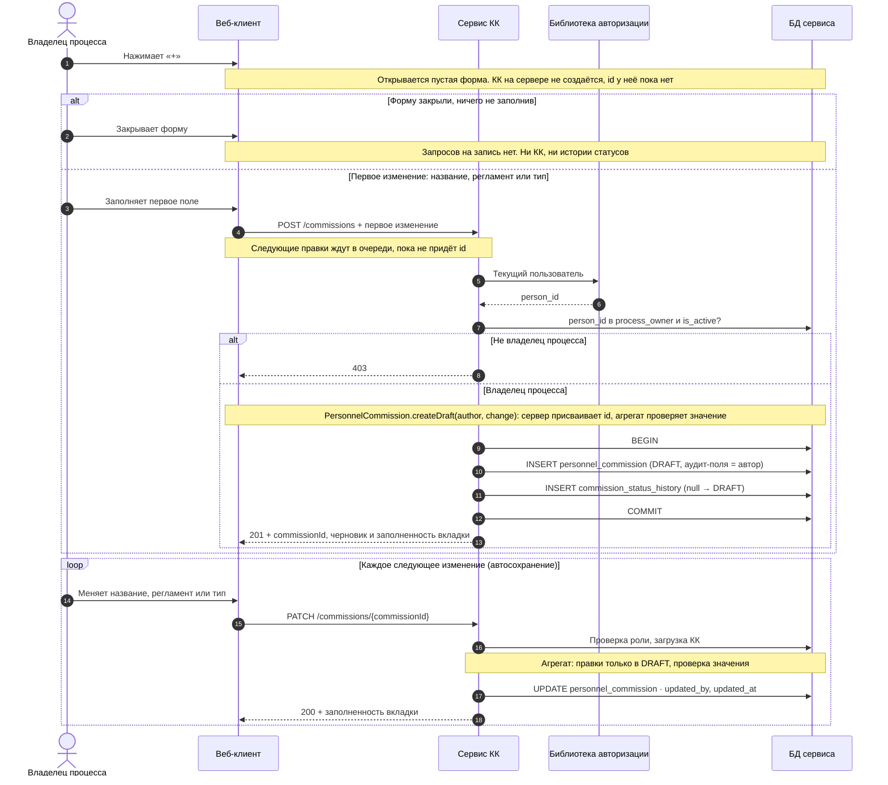

# Интент: каркас черновика кадровой комиссии

Change-id: `add-commission-draft-core`. Capability: `personnel-commission-draft`. Это задачка №1 из «Нарезки фазы A».

## Зачем

Альфа-КК сейчас готовят в Excel и почте (BR-01). Первый срез даёт корень агрегата `PersonnelCommission`. Владелец процесса создаёт КК в статусе «Черновик» и заполняет её общие сведения, а изменения сохраняются автоматически. Заодно срез приносит общую инфраструктуру, на которой строятся все следующие задачки:
- текущий пользователь;
- проверка роли;
- аудит-поля;
- порт персданных;
- dev-фикстуры.

## Что входит

1. **Текущий пользователь.** `person_id` определяется через существующую библиотеку авторизации.
2. **Справочник владельцев процесса** `process_owner` наполняется миграцией. Роль проверяется на каждой операции.
3. **Общие правила таблиц:**
   - суррогатный `id`;
   - аудит-поля `created_at`, `created_by`, `updated_at`, `updated_by`, которые заполняются автоматически на уровне персистентности.
4. **`PersonProfilePort`** с фейком: ФИО автора КК в ответе.
5. **Создание черновика при первом изменении** (FR-A02). «+» только открывает пустую форму. КК создаётся первым `POST /commissions` вместе с первым изменённым полем. Id присваивает сервер.
6. **Автосохранение** `title`, `regulation`, `type`: каждое поле отдельной правкой, при одновременных правках выигрывает последняя (last-write-wins).
7. **Получение КК** вместе с заполненностью вкладки «Параметры проведения».
8. **История статусов**: при создании записывается переход `null → DRAFT`.
9. **Dev-профиль** с фикстурами: несколько владельцев процесса и людей в фейке `PersonProfile`.

## Что не входит

Каждый пункт ниже — отдельная задачка из нарезки.

- Список КК и удаление черновика (2).
- Грейды (A3), подразделения (A4), этапы (B5), шаблон (C8). Поля `grade_codes[]` и `decision_template_id` в этом срезе не трогаются. Добавлять их колонки сейчас или в своих срезах, решает design.md.
- «Создать», «Создать на основе», «Настроить доступ».
- `change_log`: ни запись, ни просмотр (решение 01.11).
- Админка справочников (15).

## Действующие лица

- **Владелец процесса** (`ProcessOwner`) — единственная роль этого среза. Он создаёт и правит любые черновики, в том числе созданные коллегами.
- **Все остальные** получают 403.

## Термины

Термины берутся из глоссария документа «Кадровые комиссии: глоссарий и требования», новых этот change не вводит.

| Термин | Имя в коде |
| --- | --- |
| Кадровая комиссия, КК | `PersonnelCommission`, таблица `personnel_commission` |
| Параметры проведения комиссии | `CommissionParams` — значение-объект в коде, колонки `personnel_commission` в базе |
| Тип КК | `CommissionType`: `ALPHA`, `BETA`, `GAMMA` |
| Регламент | `regulation` — текстовое поле внутри параметров |
| Черновик | статус `DRAFT` |
| Владелец процесса | `ProcessOwner`, таблица `process_owner` |

В API не используются «блок», «Данные КК», «Регламент» как название раздела и `CommissionData` (FR-X06).

## Внешние зависимости

| Порт → система | Что даёт | Что ждём от системы |
| --- | --- | --- |
| Библиотека авторизации | `person_id` текущего пользователя | Уже есть, нужно подключить |
| `PersonProfilePort` → `PersonProfile` | ФИО по `person_id`, пакетом | `person_id`, фамилия, имя, отчество. API пока нет — фейк в тестах и dev-профиле |

Персданные сервис не хранит, только `person_id`.

## Данные

- **`process_owner`**: `id`, `person_id` (unique), `team`, `is_active` и аудит-поля. Наполняется миграцией.
- **`personnel_commission`**: `id`, `status`, `title`, `regulation`, `type` и аудит-поля. `created_by` — автор КК. Поля `version` нет.
- **`commission_status_history`**: `id`, `commission_id`, `from_status`, `to_status` и аудит-поля. Строки неизменяемы.

## Требования и сценарии

### Создание черновика

- **Сценарий: форма закрыта пустой.** Дано: владелец процесса нажал «+». Когда он закрывает форму, ничего не заполнив, тогда на сервер не уходит ни одного запроса на запись. Нет ни КК, ни записи в истории статусов.
- **Сценарий: первое изменение.** Когда владелец процесса заполняет первое поле (название, регламент или тип), тогда `POST /commissions` создаёт КК в `DRAFT` с этим значением. `created_by` и `updated_by` — его `person_id`. В историю статусов записывается `null → DRAFT`. Ответ 201 содержит `commissionId`, присвоенный сервером, и заполненность вкладки.
- **Сценарий: правки до ответа.** Пока `POST` не вернул id, клиент держит следующие правки в очереди и после ответа отправляет их как `PATCH`. Сам `POST` клиент не повторяет. Это требование к клиенту, а сервер не принимает `PATCH` без id.
- **Сценарий: значение очистили.** Дано: черновик создан, и владелец стёр единственное заполненное поле. Тогда КК остаётся черновиком и автоматически не удаляется.
- **Сценарий: нет прав.** Дано: пользователя нет в `process_owner`, или он неактивен. Тогда любая операция этого среза возвращает 403 и ничего не меняет.

### Автосохранение параметров

- **Сценарий: правка поля.** Когда владелец процесса меняет `title`, `regulation` или `type`, тогда сохраняется только это поле, а у КК обновляются `updated_by` и `updated_at`.
- **Сценарий: недопустимое значение.** Если тип не входит в `CommissionType` или текст длиннее лимита (лимиты задаёт design.md), запрос отклоняется 422, и черновик не меняется.
- **Сценарий: КК не в черновике.** Дано: КК не в `DRAFT`. Тогда правка отклоняется. До появления активации такое состояние получается только фикстурой, но инвариант живёт в агрегате уже сейчас.
- **Сценарий: одновременные правки.** Когда два владельца процесса одновременно меняют одно поле, сохраняется последнее изменение.

### Получение и заполненность

- **Сценарий: открыть черновик.** Когда владелец процесса открывает КК, тогда получает:
  - `title`, `regulation`, `type`, `status`;
  - автора с ФИО через `PersonProfilePort`;
  - даты создания и последнего изменения;
  - заполненность вкладки «Параметры проведения».
- **Правило заполненности этого среза:** заполнены `title` и `type`. Ответ содержит признак `complete` и список незаполненных обязательных полей. Следующие срезы добавляют свои правила: грейды, подразделения, шаблон. Поэтому формат ответа должен позволять дописывать правила, не ломая контракт.
- **Сценарий: `PersonProfile` недоступен.** КК всё равно открывается. Вместо ФИО приходит `person_id` с признаком «ФИО недоступно».

## Sequence: создание черновика

Это ориентир для design.md: пути и коды ответов уточняются в proposal вместе с фрагментом OpenAPI.

## Нефункциональные требования

- Инварианты проверяются в агрегате `PersonnelCommission`, а не в контроллере: правки только в `DRAFT`, допустимые значения, заполненность.
- Аудит-поля заполняются автоматически, а не вручную в каждом use case.
- Создание КК и запись в историю статусов выполняются в одной транзакции.
- Фрагмент OpenAPI фиксируется в proposal, до реализации.
- Фейки портов работают и в тестах, и в dev-профиле.

## Решения, принятые для этого change

1. Черновики правит только владелец процесса. Права владельца комиссии появятся в задачке 14.
2. В черновике можно выбрать любой тип, а ограничение «активировать только ALPHA» появится в задачке 11.
3. Уникальность названия не проверяется (FR-A15).
4. Id КК присваивает сервер. Защиты от повтора первого `POST` на сервере нет (решение 02.11): клиент его не повторяет, а случайный дубль при обрыве связи владелец удалит сам.
5. `change_log` в этом срезе не пишется.

## Критерии приёмки

- «+» и закрытие пустой формы не оставляют в базе ни КК, ни записей истории.
- Первое изменение создаёт КК в `DRAFT` с id от сервера.
- После перезагрузки название, регламент и тип на месте, без явного сохранения.
- Пользователь вне `process_owner` получает 403 на любую операцию.
- Черновик без типа возвращает `complete = false` и `type` в списке незаполненных полей.
- У каждой таблицы среза есть `id` и все четыре аудит-поля, они заполняются автоматически.
- В базе нет ФИО и других персданных.
- Тесты покрывают сценарии выше на фейковых адаптерах.
